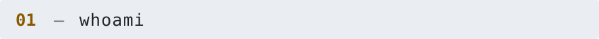
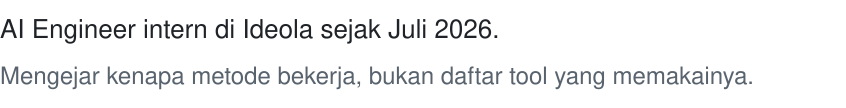
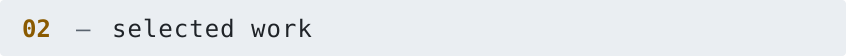
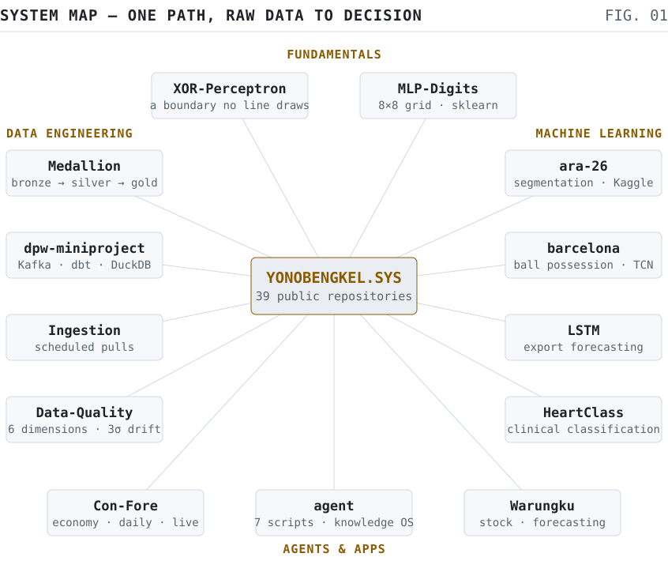
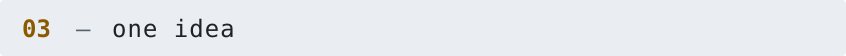
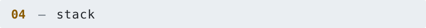
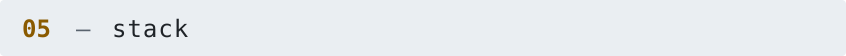
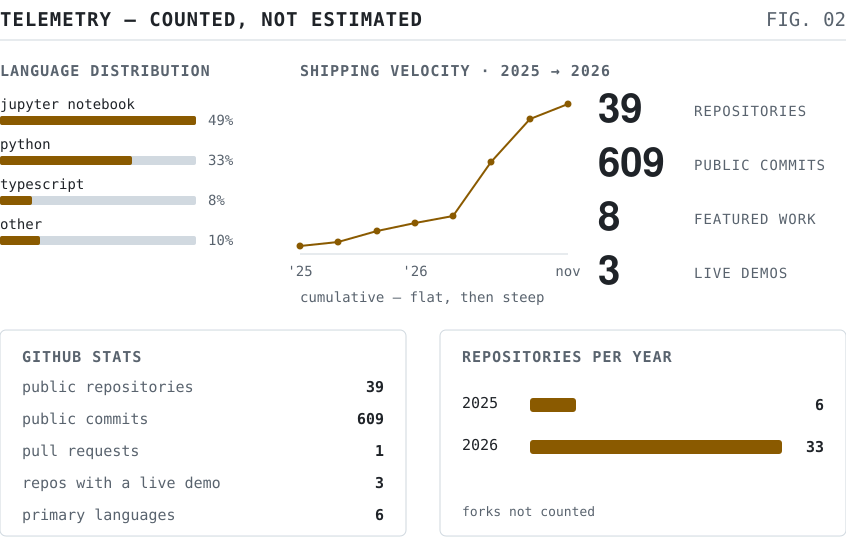
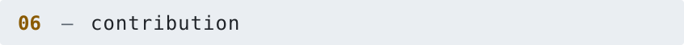

<picture><source media="(prefers-color-scheme: dark)" srcset="assets/dark/hero.svg"/></picture>

<a href="https://ilhambintangporto.vercel.app"><picture><source media="(prefers-color-scheme: dark)" srcset="https://img.shields.io/badge/PORTFOLIO-0d1117?style=flat-square&logo=vercel&logoColor=ffffff"/></picture></a>
<a href="https://www.linkedin.com/in/ilham-bintang-satria-100305blltrjttmr/"><picture><source media="(prefers-color-scheme: dark)" srcset="https://img.shields.io/badge/LINKEDIN-0d1117?style=flat-square&logo=linkedin&logoColor=ffffff"/></picture></a>
<a href="mailto:ilhambintang437@gmail.com"><picture><source media="(prefers-color-scheme: dark)" srcset="https://img.shields.io/badge/EMAIL-0d1117?style=flat-square&logo=gmail&logoColor=ffffff"/></picture></a>

<picture><source media="(prefers-color-scheme: dark)" srcset="assets/dark/s01.svg"/></picture>
<picture><source media="(prefers-color-scheme: dark)" srcset="assets/dark/whoami.svg"/></picture>

<picture><source media="(prefers-color-scheme: dark)" srcset="assets/dark/s02.svg"/></picture>
<picture><source media="(prefers-color-scheme: dark)" srcset="assets/dark/map.svg"/></picture>

<picture><source media="(prefers-color-scheme: dark)" srcset="assets/dark/s03.svg"/></picture>

| Project | What it is | Stack |
| --- | --- | --- |
| **[Con-Fore](https://github.com/YonoBengkel/Con-Fore)** | Public site that explains Indonesia's economy through growth, inflation and unemployment, refreshed by a daily pipeline, with forecasts and backtests · [live](https://con-fore.vercel.app) | Python · Supabase |
| **[barcelona](https://github.com/YonoBengkel/barcelona)** | Team entry for More than a Hack 2027 (Metrica Sports × FC Barcelona): says who has the ball on every frame of a match, with a temporal convolutional network | Python |
| **[Medallion](https://github.com/YonoBengkel/Medallion)** | CRM + ERP sales warehouse on bronze–silver–gold layers, with an as-of join so historical cost is read at transaction date | Python · SQL |
| **[dpw-miniproject](https://github.com/YonoBengkel/dpw-miniproject)** | Event-to-warehouse pipeline: batch and Kafka ingestion under one data contract, Polars transforms, a dbt star schema on DuckDB | Kafka · dbt · DuckDB |
| **[Data-Quality](https://github.com/YonoBengkel/Data-Quality)** | Six quality dimensions and 3σ drift monitoring over 120 synthetic rows, including how one bad row bends a regression line | pandas · sklearn |
| **[ara-26](https://github.com/YonoBengkel/ara-26)** | Road damage segmentation for ARA ITS 2026, three models ensembled by averaging probabilities, 0.70773 on Kaggle | PyTorch |
| **[agent](https://github.com/YonoBengkel/agent)** | Seven dependency-light scripts running one knowledge workspace, 0.889 holdout recall on the retrieval test | Python |
| **[Warungku](https://github.com/YonoBengkel/Warungku)** | Shop owner portal for warehouse stock and demand forecasting, built by a team of four | TypeScript |

<picture><source media="(prefers-color-scheme: dark)" srcset="assets/dark/s04.svg"/></picture>

<picture><source media="(prefers-color-scheme: dark)" srcset="assets/dark/s05.svg"/></picture>
<picture><source media="(prefers-color-scheme: dark)" srcset="assets/dark/telemetry.svg"/></picture>

<picture><source media="(prefers-color-scheme: dark)" srcset="assets/dark/s06.svg"/></picture>

<picture><source media="(prefers-color-scheme: dark)" srcset="https://raw.githubusercontent.com/YonoBengkel/YonoBengkel/output/snake-dark.svg?v=2"/></picture>

<picture><source media="(prefers-color-scheme: dark)" srcset="assets/dark/thanks.svg"/></picture>

### [ilhambintangporto.vercel.app](https://ilhambintangporto.vercel.app)

<!-- Visuals are generated: edit tools/build.py, then run `python tools/build.py`.
     Icons are vendored by tools/fetch_icons.py into tools/icons/.
     The snake comes from .github/workflows/snake.yml into the `output` branch. -->
