<picture><source media="(prefers-color-scheme: dark)" srcset="assets/dark/hero.svg"/></picture>

<a href="https://ilhambintangporto.vercel.app"><picture><source media="(prefers-color-scheme: dark)" srcset="https://img.shields.io/badge/PORTOFOLIO-0d1117?style=flat-square&logo=vercel&logoColor=ffffff"/></picture></a>
<a href="https://www.linkedin.com/in/ilham-bintang-satria-100305blltrjttmr/"><picture><source media="(prefers-color-scheme: dark)" srcset="https://img.shields.io/badge/LINKEDIN-0d1117?style=flat-square&logo=linkedin&logoColor=ffffff"/></picture></a>
<a href="mailto:ilhambintang437@gmail.com"><picture><source media="(prefers-color-scheme: dark)" srcset="https://img.shields.io/badge/EMAIL-0d1117?style=flat-square&logo=gmail&logoColor=ffffff"/></picture></a>

<picture><source media="(prefers-color-scheme: dark)" srcset="assets/dark/s01.svg"/>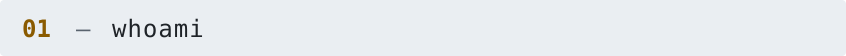</picture>
<picture><source media="(prefers-color-scheme: dark)" srcset="assets/dark/whoami.svg"/>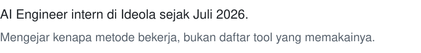</picture>

<picture><source media="(prefers-color-scheme: dark)" srcset="assets/dark/s02.svg"/>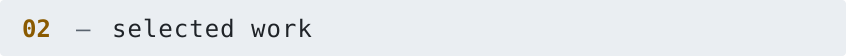</picture>
<picture><source media="(prefers-color-scheme: dark)" srcset="assets/dark/map.svg"/>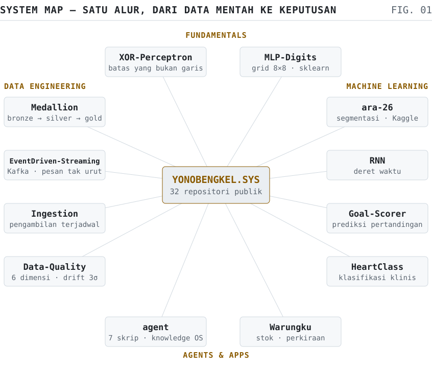</picture>

<picture><source media="(prefers-color-scheme: dark)" srcset="assets/dark/s03.svg"/>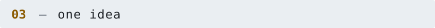</picture>

| Proyek | Ringkas | Stack |
| --- | --- | --- |
| **[Medallion](https://github.com/YonoBengkel/Medallion)** | Gudang data CRM + ERP, lapisan bronze–silver–gold, as-of join untuk harga pokok historis | Python · SQL |
| **[Data-Quality](https://github.com/YonoBengkel/Data-Quality)** | Enam dimensi mutu dan drift 3σ atas 120 baris sintetis, plus simulasi satu baris cacat membelokkan regresi | pandas · sklearn |
| **[ara-26](https://github.com/YonoBengkel/ara-26)** | Segmentasi kerusakan jalan ARA ITS 2026, ensemble rata-rata probabilitas tiga model, Kaggle 0.70773 | PyTorch |
| **[agent](https://github.com/YonoBengkel/agent)** | Tujuh skrip tanpa dependensi berat untuk satu knowledge workspace, recall holdout 0.889 | Python |
| **[EventDriven-Streaming](https://github.com/YonoBengkel/EventDriven-Streaming)** | Pipeline ingesti Apache Kafka: produser, konsumer, penanganan pesan tak berurutan | Kafka |
| **[Warungku](https://github.com/YonoBengkel/Warungku)** | Portal pemilik usaha untuk stok gudang dan perkiraan kebutuhan, tim berempat | TypeScript |

<picture><source media="(prefers-color-scheme: dark)" srcset="assets/dark/s04.svg"/>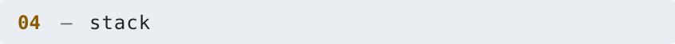</picture>

&nbsp;&nbsp;
&nbsp;&nbsp;
&nbsp;&nbsp;
&nbsp;&nbsp;
&nbsp;&nbsp;

  
&nbsp;&nbsp;
&nbsp;&nbsp;
&nbsp;&nbsp;
&nbsp;&nbsp;
&nbsp;&nbsp;

<picture><source media="(prefers-color-scheme: dark)" srcset="assets/dark/s05.svg"/>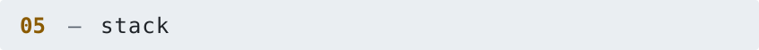</picture>
<picture><source media="(prefers-color-scheme: dark)" srcset="assets/dark/telemetry.svg"/>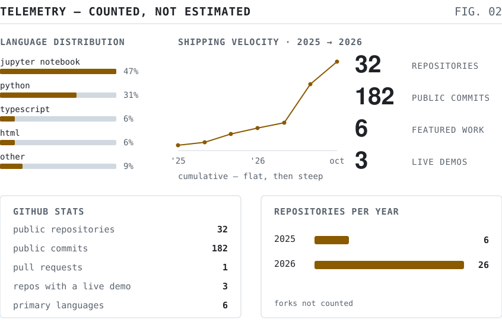</picture>

<picture><source media="(prefers-color-scheme: dark)" srcset="assets/dark/s06.svg"/>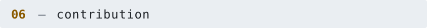</picture>

<picture><source media="(prefers-color-scheme: dark)" srcset="https://raw.githubusercontent.com/YonoBengkel/YonoBengkel/output/snake-dark.svg"/></picture>

<picture><source media="(prefers-color-scheme: dark)" srcset="assets/dark/footer.svg"/>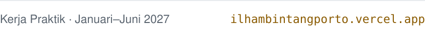</picture>

<!-- Visuals are generated: edit tools/build.py, then run `python tools/build.py`.
     The snake comes from .github/workflows/snake.yml into the `output` branch. -->
